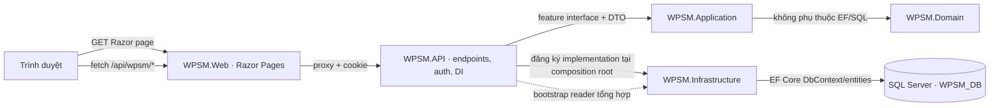

# Hướng dẫn phát triển WPSM

Tài liệu này giúp thành viên mới chạy dự án, hiểu luồng từ màn hình đến SQL Server, biết file nào thuộc feature mình phụ trách và phối hợp thay đổi mà không làm lệch database hoặc API. Tài liệu mô tả solution hiện tại: Razor Pages trong `WPSM.Web`, ASP.NET Core API và các project `Application`, `Domain`, `Infrastructure` trên .NET 8.

> **Tình trạng hiện tại:** solution đã có luồng database-backed cho Iteration 1 và repository đã chia theo feature. Một số tính năng phía sau Iteration 1 và một số tích hợp được mô tả trong Report 4 chưa được triển khai. Hãy kiểm tra Report 2 để xác định phạm vi iteration, Report 3 để xác định yêu cầu chức năng, Report 4 để hiểu thiết kế mục tiêu và thư mục `Screens` để xem đặc tả giao diện.

## 1. Bắt đầu làm việc với dự án

### 1.1 Công cụ cần có

- .NET 8 SDK.
- SQL Server hoặc SQL Server LocalDB. SQL Server là nơi lưu dữ liệu; LocalDB là cách chạy SQL Server cục bộ trên máy Windows cho phát triển.
- SQL Server Management Studio (SSMS) hoặc công cụ tương đương để chạy script và xem dữ liệu.
- Git và IDE/editor hỗ trợ .NET.

### 1.2 Khởi tạo database

Nhóm thống nhất dùng cùng schema và bộ dữ liệu khởi tạo. Thông thường mỗi thành viên chạy database riêng trên máy mình bằng cùng script; không bắt buộc cả nhóm dùng một server online chung.

1. Mở `../Docs/WPSM_DB_Schema.sql` bằng SSMS và chạy trên SQL Server. Trong workspace hiện tại, thư mục `Docs` chứa report/schema đang nằm cạnh thư mục solution; script tạo database `WPSM_DB` nếu chưa có và tạo các bảng/ràng buộc/index hiện được định nghĩa trong đó.
2. Connection mặc định của Development nằm trong `src/API/appsettings.Development.json` và dùng `(localdb)\MSSQLLocalDB`. Nếu dùng SQL Server khác, mỗi thành viên đặt connection string riêng bằng User Secrets, không sửa connection string cá nhân vào file được commit:

   ```powershell
   dotnet user-secrets set "ConnectionStrings:WpsmDb" "<connection-string-cua-may-ban>" --project src/API/WPSM.API.csproj
   ```

3. Bật development seeder và cấu hình tài khoản dev của riêng mình. Thay các giá trị mẫu bằng email/mật khẩu do thành viên tự chọn; mật khẩu tối thiểu 12 ký tự:

   ```powershell
   dotnet user-secrets set "Wpsm:SeedDevelopmentData" "true" --project src/API/WPSM.API.csproj
   dotnet user-secrets set "Wpsm:Seed:Admin:Email" "admin@wpsm.local" --project src/API/WPSM.API.csproj
   dotnet user-secrets set "Wpsm:Seed:Admin:Password" "<mat-khau-dev-rieng>" --project src/API/WPSM.API.csproj
   dotnet user-secrets set "Wpsm:Seed:Manager:Email" "manager@wpsm.local" --project src/API/WPSM.API.csproj
   dotnet user-secrets set "Wpsm:Seed:Manager:Password" "<mat-khau-dev-rieng>" --project src/API/WPSM.API.csproj
   ```

   `UserSecretsId` đã có trong `src/API/WPSM.API.csproj`, nên không cần chạy `user-secrets init`.

4. Seeder chạy khi API khởi động trong môi trường Development và tạo tài khoản Admin/Manager, sảnh, ca tiệc, Catalog, PriceFrames và policy cơ bản. Seeder dùng dữ liệu cấu hình idempotent ở mức kiểm tra bản ghi đã có trước khi thêm; nếu đổi seed đã có, cần sửa dữ liệu trong SQL/SSMS hoặc bổ sung quy tắc cập nhật có chủ ý.

`WPSM_DB_Schema.sql` hiện là script schema. Dữ liệu khởi tạo hiện nằm trong `src/API/DevelopmentDatabaseSeeder.cs`, không phải trong SQL script. Nếu nhóm muốn quy trình một script duy nhất, cần thống nhất rồi chuyển seed dữ liệu cố định vào script hoặc duy trì một `WPSM_DB_Seed.sql` riêng. Không đưa mật khẩu thật vào script dùng chung.

### 1.3 Chạy ứng dụng

Mở hai terminal tại thư mục solution `SEP490_139_WPSM`.

Terminal 1 – API:

```powershell
dotnet run --project src/API/WPSM.API.csproj --launch-profile http
```

Terminal 2 – Razor Web:

```powershell
dotnet run --project WPSM.Web/WPSM.Web.csproj --launch-profile http
```

Mở `http://localhost:5231/G01`. Web gọi API qua proxy cùng origin tại `/api/wpsm/*`; API mặc định chạy ở `http://localhost:5128`. Giữ cả hai tiến trình chạy khi thao tác trên giao diện.

### 1.4 Kiểm tra nhanh trước khi nhận feature

- `dotnet build WPSM.sln --no-restore -m:1` build thành công.
- API khởi động mà không báo thiếu connection string hoặc lỗi kết nối SQL Server.
- Đăng nhập bằng tài khoản dev vừa seed.
- Kiểm tra role chuyển đúng trang; thử một luồng đọc dữ liệu và một luồng ghi dữ liệu trong phạm vi được giao.
- Nếu API trả 503, kiểm tra SQL Server đang chạy, database đã tạo, connection string đúng và user có quyền.
- Nếu API trả 401/403, kiểm tra đăng nhập, cookie và role; build thành công không xác nhận các điều kiện này.

## 2. Kiến trúc và luồng tương tác giữa project



Luồng đọc/ghi thường gặp:

1. Thành viên tạo hoặc chỉnh `.cshtml` và JavaScript trong `WPSM.Web`.
2. JavaScript gọi `/api/wpsm/...`; không gọi trực tiếp SQL Server và không tham chiếu `Infrastructure`.
3. `WPSM.Web/Program.cs` chuyển request tới API, chuyển cookie xác thực đi/về và bảo vệ một số Razor routes theo role.
4. `src/API/Program.cs` định nghĩa API endpoint, authorization và đăng ký implementation qua Dependency Injection.
5. Endpoint gọi interface feature nằm trong `Application/Persistence`.
6. Implementation tại `Infrastructure/Persistence` dùng `WpsmDbContext`/EF Core để đọc hoặc ghi bảng.
7. DTO trả về API rồi JavaScript cập nhật màn hình.

**Quy tắc phụ thuộc:** Web chỉ biết HTTP/API; Application chứa contract dùng chung; Infrastructure chứa chi tiết SQL/EF; API là composition root nối interface với implementation. Không để Razor Page hoặc API endpoint tự truy vấn `WpsmDbContext`.

## 3. Ý nghĩa project và folder

### `WPSM.Web`

Ứng dụng giao diện Razor Pages và static assets.

- `Areas/General/Pages`: login, hồ sơ, đổi mật khẩu (G01–G03).
- `Areas/Admin/Pages`: Catalog, PriceFrames, Policies (A02–A08; một số màn/dialog dùng chung page).
- `Areas/Manager/Pages`: danh sách/tạo dự án, project hub, đặc tả (M02–M05).
- `Areas/Customer/Pages`: tổng quan, hợp đồng, roadmap (C01–C04).
- `Areas/*/Pages/Shared`: navigation dùng chung theo role.
- `Pages/Shared/_Layout.cshtml`: layout chung; `_ViewStart.cshtml` chọn layout mặc định.
- `wwwroot/js/wpsm-api.js`: gọi API, submit handler, hydration dữ liệu từ bootstrap. Trước khi thêm handler, tìm handler cũ theo screen ID để tránh xử lý submit/click hai lần.
- `wwwroot/js/wpsm-theme.js`, `wwwroot/css/wpsm.css`, `site.css`: giao diện và theme.
- `Program.cs`: Razor services, API `HttpClient`, proxy `/api/wpsm/*`, kiểm tra role cho routes và route aliases.
- `appsettings.json`: cấu hình không bí mật; `appsettings.Development.json`: cấu hình phát triển như API base URL.

### `src/API`

ASP.NET Core Web API, authentication/authorization và nơi khởi tạo ứng dụng.

- `Program.cs`: đọc connection string, đăng ký `DbContext`, repositories, hasher, cookie auth, middleware lỗi và endpoints `/api/wpsm/*`.
- `DevelopmentDatabaseSeeder.cs`: tạo tài khoản dev và dữ liệu tham chiếu khi bật seed trong Development.
- `appsettings.Development.json`: connection mặc định LocalDB và cờ seed mặc định tắt.
- `Properties/launchSettings.json`: profile/port chạy local.
- `WpsmPortalStore.cs`: store in-memory cũ; code hiện tại không nên dùng file này cho chức năng database-backed. Các luồng đang dùng repository EF trong Infrastructure.

### `src/Application`

Contract giữa API và persistence, cùng DTO/command cho các luồng hiện tại.

- `Persistence/WpsmPortalContracts.cs`: DTO/command/response như `WeddingProjectView`, `CatalogItemView`, `PolicyCommand`, `ProfileCommand`.
- `Persistence/IProjectRepository.cs`: đọc/tạo dự án, ghi nhận biên nhận NRD.
- `Persistence/ISpecificationRoadmapRepository.cs`: sửa đặc tả, freeze baseline và đọc roadmap.
- `Persistence/IConfigurationRepository.cs`: Catalog, PriceFrames, Policies.
- `Persistence/IAccountProfileRepository.cs`: tra cứu tài khoản, đổi password và hồ sơ.
- `Persistence/IWpsmPortalSnapshotReader.cs`: contract đọc gói dữ liệu bootstrap cho giao diện.
- `Features`, `DTOs`, `Behaviors` hiện chủ yếu là khung/thư mục; khi nhóm bổ sung Application handlers/use cases, đặt logic ứng dụng ở đây theo quy ước nhóm thống nhất.

### `src/Domain`

Nơi đặt quy tắc nghiệp vụ thuần, trạng thái và value objects, không phụ thuộc database, HTTP hay Razor. Hiện project còn trống/placeholder; không nhầm với entity EF đang nằm trong Infrastructure. Khi bổ sung quy tắc phức tạp (ví dụ chuyển trạng thái Change Request hoặc tính surcharge), đưa logic thuần vào Domain thay vì nhồi thêm vào endpoint hoặc EF repository.

### `src/Infrastructure`

Chi tiết truy cập dữ liệu/EF Core và implementation của contract Application.

- `Persistence/WpsmDbContext.cs`: ánh xạ DbSet, quan hệ, cột, index và constraint với database-first schema.
- `Persistence/Entities`: EF entity sinh/ánh xạ bảng SQL. Thay đổi schema phải rà cả file này và DbContext.
- `Persistence/ProjectRepository.cs`: thao tác dữ liệu dự án và NRD.
- `Persistence/SpecificationRoadmapRepository.cs`: đặc tả, baseline freeze, roadmap.
- `Persistence/ConfigurationRepository.cs`: Catalog, PriceFrames, Policies.
- `Persistence/AccountProfileRepository.cs`: account/password/profile.
- `Persistence/WpsmPortalSnapshotReader.cs`: ghép dữ liệu từ các repository cho endpoint bootstrap; không thêm các thao tác ghi feature vào đây.
- `Persistence/ProjectReadModel.cs`: truy vấn/ánh xạ dữ liệu dự án sang DTO.
- `WpsmCategoryNames.cs`, `WpsmValueNormalizer.cs`: chuẩn hóa tên danh mục/giá trị dùng trong persistence.

### `Docs` và `Screens`

- `../Docs/WPSM_Report2_Project management plan.docx`: iteration và kế hoạch.
- `../Docs/WPSM_Report3_Software Requirement Specification.docx`: yêu cầu nghiệp vụ/use case.
- `../Docs/WPSM - Report 4 - Software Design Specification (3).docx`: thiết kế mục tiêu; cần giữ kiến trúc Razor Pages, route, auth và schema đồng bộ với quyết định/code mới nhất.
- `../Docs/WPSM_DB_Schema.sql`: schema SQL đang dùng làm cơ sở database-first.
- `../Screens/<Role>/<Screen>/DESIGN.md`: trạng thái, trường dữ liệu và hành vi UI cho từng màn hình (thư mục này hiện cũng nằm ngoài Git root).

## 4. Chia repository theo feature

| Nhóm | Contract Application | Implementation Infrastructure | Phạm vi hiện tại |
|---|---|---|---|
| Dự án | `IProjectRepository` | `ProjectRepository` | Danh sách/chi tiết/tạo dự án, ghi nhận NRD |
| Đặc tả và roadmap | `ISpecificationRoadmapRepository` | `SpecificationRoadmapRepository` | Sửa đặc tả, freeze baseline, tạo/đọc roadmap |
| Cấu hình Admin | `IConfigurationRepository` | `ConfigurationRepository` | Catalog, PriceFrames, Policies |
| Tài khoản/hồ sơ | `IAccountProfileRepository` | `AccountProfileRepository` | Tra cứu account, đăng nhập hỗ trợ, password, profile |
| Bootstrap màn hình | `IWpsmPortalSnapshotReader` | `WpsmPortalSnapshotReader` | Chỉ tổng hợp DTO cho UI; phụ thuộc các interface feature |

Khi bắt đầu feature mới, thêm contract hẹp cho feature thay vì nối thêm mọi method vào một repository chung. Giữ query/write liên quan trong cùng feature; chỉ tách interface mới khi có trách nhiệm riêng rõ ràng. Register implementation tương ứng trong `src/API/Program.cs`.

## 5. Quy trình trước và trong khi phát triển feature

### Trước khi code

1. Xác nhận feature thuộc iteration nào; đọc use case trong Report 3 và screen design liên quan.
2. Thống nhất acceptance criteria: ai được dùng, dữ liệu đầu vào/đầu ra, trạng thái trước/sau, lỗi mong đợi.
3. Xác định bảng SQL liên quan, contract API và interface/repository feature sẽ dùng.
4. Kiểm tra feature có thay schema không. Nếu có, giao một người điều phối schema; không để nhiều branch sửa độc lập cùng bảng/script.
5. Tạo branch từ nhánh nhóm đã thống nhất, ví dụ `feature/iteration1-project-baseline`.
6. Chia quyền sở hữu file. Tránh để nhiều thành viên cùng sửa `src/API/Program.cs`, `wpsm-api.js`, `WpsmDbContext.cs` hoặc SQL script trong cùng lúc; người phụ trách feature phối hợp với người giữ file composition/shared UI.

### Trong khi code

1. UI: sửa đúng Razor Area/page; giữ role routing và ID/data attributes mà JavaScript hiện dùng.
2. API: thêm endpoint mỏng, kiểm tra input và role; endpoint chỉ phụ thuộc contract feature.
3. Application: thêm/chỉnh DTO, command và interface trước khi Infrastructure implement; báo cho thành viên phụ thuộc khi contract đổi.
4. Infrastructure: thực hiện query/update EF trong repository của đúng feature; không trả EF entity trực tiếp ra API.
5. Domain/Application: đặt quy tắc nghiệp vụ độc lập với database ở lớp nghiệp vụ, không để UI quyết định quy tắc có ảnh hưởng dữ liệu.
6. Schema: cập nhật SQL script, DbContext và entity đồng bộ; seed chỉ thêm dữ liệu cần cho chạy/demo và phải tránh tạo trùng.
7. Bảo mật: không commit connection string/password thật; không trả `PasswordHash`; giới hạn quyền truy cập theo role và project ownership; file upload không đặt trong `wwwroot`.
8. Sau mỗi thay đổi contract, kiểm tra cùng người làm UI/API/Infrastructure để tên JSON, kiểu dữ liệu và status code khớp nhau.

### Trước khi mở PR/merge

- Build solution: `dotnet build WPSM.sln --no-restore -m:1`.
- Chạy luồng đã sửa trên database local có schema/seed; kiểm tra cả trường hợp hợp lệ và lỗi chính.
- Kiểm tra role trái phép, dữ liệu thiếu/trùng và ngày/tiền không hợp lệ nếu feature có liên quan.
- Rà `git diff` để chắc không commit `bin/`, `obj/`, secrets, dữ liệu cá nhân hoặc thay đổi không thuộc task.
- Cập nhật README/Report/design docs nếu route, schema, auth hoặc flow đã đổi.
- Trong mô tả PR ghi: use case, file/lớp đã sửa, schema/seed cần chạy, cách kiểm tra và giới hạn còn lại.

## 6. Quy tắc database-first và seed

SQL script là định nghĩa schema mà nhóm chạy trên SQL Server; `WpsmDbContext` và EF entities là mapping trong code. Không coi thay đổi trong DbContext tự động cập nhật database, vì hiện nhóm chưa dùng EF migrations làm workflow chính.

Khi thêm/sửa cột, bảng, constraint hoặc index:

1. Cập nhật `../Docs/WPSM_DB_Schema.sql` trong workspace hiện tại (idempotent, không drop dữ liệu tùy tiện); khi nhóm đưa schema vào Git repository thì cập nhật đường dẫn theo vị trí mới.
2. Áp dụng thay đổi lên database dev sạch và kiểm tra script chạy lặp lại an toàn.
3. Cập nhật/scaffold lại `WpsmDbContext` và entity tương ứng trong Infrastructure; rà tên cột, nullability, precision, FK và computed columns.
4. Cập nhật seed nếu feature cần dữ liệu khởi tạo; bảo đảm chạy nhiều lần không tạo duplicate.
5. Ghi migration/setup note trong PR để thành viên khác cập nhật local database cùng cách.

Không sửa trực tiếp database của thành viên khác nếu chưa thống nhất. Không dùng dữ liệu khách hàng thật làm seed. Nếu nhóm sau này chuyển qua EF migrations, cần chốt migration là source of truth thay vì để hai workflow schema cạnh tranh.

## 7. Lưu ý rủi ro và xử lý lỗi thường gặp

| Triệu chứng | Kiểm tra trước |
|---|---|
| API dừng ngay khi khởi động | `ConnectionStrings:WpsmDb`, SQL Server/LocalDB đang chạy, database và schema đã tạo |
| 503 từ API | SQL Server không kết nối được hoặc connection string trỏ sai instance/database |
| 401 sau đăng nhập hoặc Web chuyển về G01 | Cookie có được proxy chuyển qua không; API có chạy đúng port không; đăng nhập thành công chưa |
| 403 khi mở route | Role tài khoản không khớp route; không bỏ kiểm tra role để “cho chạy” |
| 409 khi lưu | Unique/check/FK constraint từ SQL; xem log API và nội dung lỗi trả về |
| Dữ liệu UI vẫn là mẫu | Kiểm tra `wpsm-api.js` handler, bootstrap response, `data-wpsm-screen`, query string `?id=` và API proxy |
| Bảng/column mapping lỗi | So sánh SQL script với DbContext/entity; kiểm tra tên PascalCase/casing, precision, nullability và computed field |
| Port bị chiếm | Xem `Properties/launchSettings.json`; dùng port thống nhất hoặc báo nhóm trước khi đổi |

Các file `appsettings*.json` chỉ chứa cấu hình không bí mật có thể commit. Connection string cá nhân, mật khẩu seed và secret khác để trong User Secrets hoặc biến môi trường. Không log password, token, receipt content hoặc thông tin khách hàng nhạy cảm.

## 8. Giới hạn đã biết cần nhớ khi nhận việc

- `Domain` và nhiều thư mục `Application/Features`, `Behaviors` mới là khung; không giả định đã có MediatR, pipeline behavior hoặc đầy đủ use-case handlers như thiết kế mục tiêu.
- `WpsmPortalStore.cs` là store in-memory cũ, không dùng cho luồng mới.
- Các trang đang có là phạm vi Iteration 1; việc một route có giao diện không đồng nghĩa backend đã có toàn bộ nghiệp vụ cuối cùng.
- Email gửi thông tin tài khoản chưa tích hợp; mật khẩu tạm hiện được trả cho Manager một lần để chuyển cho khách.
- NRD receipt hiện lưu file private trên local disk của API; chưa có abstraction cloud/file service.
- Cần tiếp tục đối chiếu Report 4 với quyết định Razor Pages và schema 23 bảng hiện tại khi mở rộng các iteration sau.

## 9. Quy ước phối hợp đề xuất

- Mỗi feature có một owner chịu trách nhiệm end-to-end và một người review.
- Một PR tập trung vào một feature; contract hoặc schema thay đổi phải thông báo rõ cho các PR phụ thuộc.
- Thay đổi shared contract/SQL/DbContext/DI do một người điều phối để giảm conflict.
- Không push trực tiếp vào nhánh nhóm nếu quy trình lớp yêu cầu PR.
- Nếu phát hiện thiết kế không khớp tài liệu, ghi nhận và thống nhất hướng trước khi tạo thêm cấu trúc mới.

### Checklist ngắn của thành viên

- [ ] Đọc scope/use case/screen design của feature.
- [ ] Có SQL Server local, chạy schema và seed được.
- [ ] API và Web chạy được bằng port nhóm thống nhất.
- [ ] Biết interface/repository và endpoint feature sẽ dùng.
- [ ] Không gọi DbContext từ Web/API endpoint.
- [ ] Không commit secrets hoặc `bin/obj`.
- [ ] Build và kiểm tra luồng feature trên database trước khi gửi PR.
